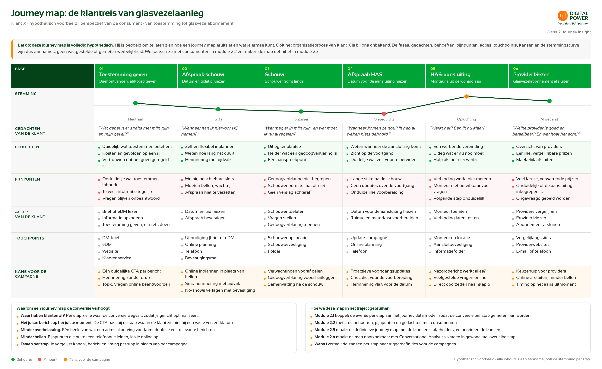
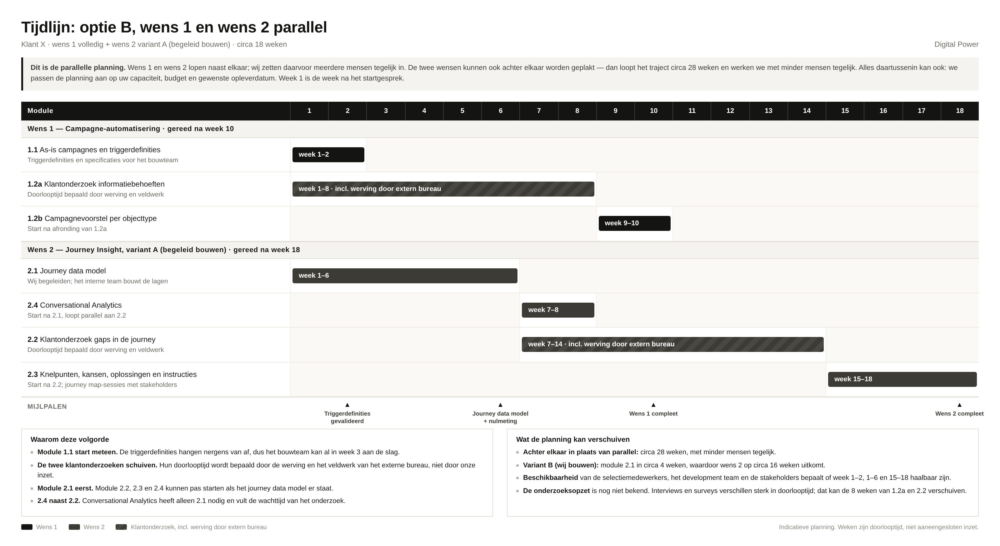

# Voorstel: van handmatige campagnes naar een gestuurde klantreis

**Klant X (glasvezelaanleg) · Digital Power, Customer Experience · Concept v1.0 · Geldig tot [datum]**

---

## 1. In het kort

In 2027 communiceert klant X met circa **150.000 adressen** via circa 20 campagnes in één project. De selectie gebeurt nu met de hand. Dat houdt de grote campagnemomenten overeind, maar het levert geen adresgerichte klantreis en geen zicht op waar consumenten afhaken.

Wij maken de campagnes event-gedreven en de klantreis meetbaar.

- **Wens 1 — Campagne-automatisering.** Campagnes worden getriggerd door events, niet door een handmatige selectie.
- **Wens 2 — Journey Insight, van data naar actie.** Een journey data model legt de klantreis per adres vast; AI versnelt de optimalisatie. Doel: hogere tevredenheid bij de consument en hogere conversie — meer toestemmingen en afspraken.

Elke module heeft één doel, één outcome en één tarief, en kan worden toegevoegd of weggelaten. Het interne team van klant X bouwt de campagnetool. Onze rol is adviserend en aansturend, of uitvoerend; dat bepaalt de gekozen variant.

> **Ons advies: optie B** — wens 1 volledig plus wens 2 variant A. **€85.800 excl. btw**, circa 18 weken.

---

## 2. Waarom Digital Power

Onze collega's hebben de **Databricks-omgeving van klant X eerder ingericht**. Daardoor blijft de technische verkenning in module 2.1 beperkt tot de aanvulling daarop en tot de vraag hoeveel website- en calldata beschikbaar is. Dat scheelt discovery-tijd, en in variant B bouwen data engineers die de omgeving al kennen.

Daarnaast brengen we consumentenonderzoek en customer experience in dezelfde opdracht samen. De triggers en de journey zijn daardoor gebaseerd op vastgestelde informatiebehoeften, niet op aannames.

---

## 3. Wens 1: Campagne-automatisering

| Module | Doel en outcome | Tarief |
|---|---|---|
| **1.1** As-is campagnes en triggerdefinities | De handmatige selectie vervangen door vastgelegde triggerdefinities, vertaald naar specificaties voor het bouwteam. **Outcome:** alle 20 campagnes, inclusief herinneringen, hebben een gevalideerde triggerdefinitie en het bouwteam kan ze bouwen zonder aanvullende uitleg. | €6.000 |
| **1.2a** Klantonderzoek informatiebehoeften | De informatiebehoeften van consumenten per objecttype vaststellen. **Outcome:** een onderzoeksrapport met een behoeftenprofiel per objecttype. | €18.000 \* |
| **1.2b** Campagnevoorstel per objecttype | De bestaande campagnes splitsen per objecttype, op basis van module 1.2a. **Outcome:** per objecttype een campagnevoorstel, met de bestaande campagnes toegewezen. | €6.000 |
| **Totaal wens 1** | | **€30.000** |

**Afhankelijkheden.** Module 1.1 en 1.2a zijn zelfstandig af te nemen. Module 1.2b is alleen af te nemen samen met 1.2a en start na afronding daarvan. Module 1.1 is niet verplicht voor 1.2b, maar maakt het campagnevoorstel direct bouwbaar.

**Deelafname.** Module 1.1 + 1.2a: €24.000. Module 1.2a + 1.2b: €24.000.

**Doorlooptijd:** circa 10 weken (1.1 circa 1 week, 1.2a circa 8 weken inclusief werving, 1.2b circa 1 à 2 weken).

\* Excl. wervingskosten van het externe onderzoeksbureau. Digital Power selecteert het bureau, tenzij klant X dit zelf wil, en levert een voorstel voor de wervingskosten. Die kosten draagt klant X.

> **Let op bij de klantonderzoeken.** Het tarief van module 1.2a en module 2.2 is een grove inschatting. De onderzoeksopzet is nog niet bekend, en de methode maakt veel uit: interviews en surveys verschillen sterk in doorlooptijd en in de manier van afnemen. Een combinatie van methoden is vaak een goede oplossing, maar dat stellen we pas definitief vast als de onderzoeksopzet er ligt. Tarief en doorlooptijd van deze twee modules bevestigen we bij het akkoord op de onderzoeksopzet; een afwijking loopt via een change request.

---

## 4. Wens 2: Journey Insight, van data naar actie

Het journey data model bestaat uit vier lagen — identity, event, journey en semantic — die samen één aanpak vormen. Klant X kiest één van twee varianten voor de bouw van module 2.1.

- **Variant A: begeleid bouwen.** Wij ontwerpen de architectuur en het datamodel, reviewen en dragen kennis over. Het eigen development team van klant X bouwt.
- **Variant B: wij bouwen.** Onze data engineers, bekend met de Databricks-omgeving, ontwerpen en bouwen de lagen. Klant X beoordeelt, accepteert en neemt over voor beheer.

| Module | Doel en outcome | Variant A | Variant B |
|---|---|---|---|
| **2.1** Journey data model | De klantreis per adres vastleggen in een schaalbaar datamodel, als basis voor geautomatiseerd inzicht en voor AI. **Outcome:** het datamodel is opgeleverd, gereviewd en gedocumenteerd, KPI's en nulmeting zijn goedgekeurd en een proof-of-concept toont de journey-performance voor één objecttype. | €16.800 | €34.500 |
| **2.2** Klantonderzoek gaps in de journey | Vaststellen waar consumenten in de klantreis vastlopen. **Outcome:** de gaps zijn vastgelegd in een onderzoeksrapport. | €18.000 \* | €18.000 \* |
| **2.3** Knelpunten, kansen, oplossingen en instructies | Eenmalig de knelpunten, kansen en oplossingen vaststellen. **Outcome:** geprioriteerde knelpunten, kansen en oplossingen, met instructies waarmee het interne team ze doorvoert. | €15.000 | €15.000 |
| **2.4** Conversational Analytics | AI op het journey data model, zodat medewerkers in gewone taal vragen stellen over de journeys. **Outcome:** een permanente voorziening met dashboard of intuïtieve interface, getest op antwoordkwaliteit, met de werkwijze en het beheer overgedragen. | €6.000 | €6.000 |
| **Totaal wens 2** | | **€55.800** | **€73.500** |

**Afhankelijkheden.** Module 2.1 is zelfstandig af te nemen en is de basis voor 2.4. Module 2.2, 2.3 en 2.4 starten na afronding van module 2.1. Module 2.3 is alleen af te nemen samen met 2.2 en wordt afgerond na 2.2. Module 2.4 is alleen af te nemen samen met 2.1.

**Aanname bij de identity layer.** De omvang van de identity layer hangt af van de huidige setup. Gebruiken de bronnen een overeenkomende ID, dan is die laag snel klaar; moeten ID's eerst in de bronsystemen worden afgevangen of afgeleid, dan kost het meer tijd. Het tarief gaat uit van overeenkomende ID's (zie hoofdstuk 9).

**Doorlooptijd:** circa 18 weken (variant A) of circa 16 weken (variant B). Module 2.2 kan langer lopen door de planning en afstemming met het wervingsbureau.

\* Excl. wervingskosten van het externe onderzoeksbureau (zie wens 1). De kanttekening bij module 1.2a over de onderzoeksopzet geldt ook voor module 2.2.

---

## 5. Visualisatie: de klantreis van glasvezelaanleg

Bij wens 2 hoort een visualisatie van de klantreis, in hoofdlijnen en vanuit het perspectief van de consument: van toestemming geven, via het inplannen van de schouw, de schouw zelf, het inplannen van de HAS-aansluiting en de HAS-aansluiting, tot het kiezen van een provider met glasvezelabonnement. Per fase staan de gedachten, behoeften, pijnpunten, acties, touchpoints en de kansen om de campagne te optimaliseren.

> **Let op: deze journey map is volledig hypothetisch.** Hij laat zien hoe een journey map eruitziet en wat je ermee kunt. Ook het proces van klant X is bij ons nog niet bekend. De fases, gedachten, behoeften, pijnpunten, acties, touchpoints, kansen en de stemmingscurve zijn dus aannames, geen vastgestelde of gemeten werkelijkheid. We toetsen ze met consumenten in module 2.2 en maken de map definitief in module 2.3, samen met klant X en de stakeholders.

---

## 6. Wat de journey map oplevert

**Waarom een journey map de campagnes verbetert en de conversie verhoogt**

- **Waar haken klanten af?** Per stap zie je waar de conversie wegvalt, zodat je gericht optimaliseert in plaats van de hele campagne aan te passen.
- **Het juiste bericht op het juiste moment.** De CTA past bij de stap waarin de klant zit, niet bij een vaste verzenddatum. Dat verhoogt de respons per bericht.
- **Minder overbelasting van een adres.** Eén beeld van wat een adres al heeft ontvangen voorkomt dubbele en irrelevante berichten, en daarmee opt-outs en bezwaren.
- **Minder bellen.** Pijnpunten die nu tot een telefoontje leiden, los je online op. Dat verlaagt de kosten en versnelt de klantreis.
- **Testen per stap.** Je vergelijkt kanaal, bericht en timing per stap in plaats van per campagne, zodat je sneller leert wat werkt.
- **Een gedeelde taal.** Marketing, operatie en development kijken naar dezelfde stappen, dezelfde knelpunten en dezelfde KPI's.

**Hoe we de map in het traject gebruiken**

- **Module 2.1** koppelt de events per stap aan het journey data model, zodat de conversie per stap gemeten kan worden.
- **Module 2.2** toetst de behoeften, pijnpunten en gedachten met consumenten.
- **Module 2.3** maakt de definitieve journey map met de klant en stakeholders, en prioriteert de kansen.
- **Module 2.4** maakt de map doorzoekbaar met Conversational Analytics: vragen in gewone taal over elke stap.
- **Wens 1** vertaalt de kansen per stap naar triggerdefinities voor de campagnes.

---

## 7. Opties

| Optie | Samenstelling | Tarief (excl. btw) | Doorlooptijd |
|---|---|---|---|
| A | Wens 1 volledig | €30.000 | circa 10 weken |
| **B (aanbevolen)** | **Wens 1 volledig + wens 2 variant A** | **€85.800** | **circa 18 weken** |
| C | Wens 1 volledig + wens 2 variant B | €103.500 | circa 16 weken |

**Waarom optie B?** Klant X wil zelf inhouse bouwen. In variant A blijven de kennis en het eigenaarschap bij klant X en is de investering lager dan in variant B. Wens 1 levert direct waarde; wens 2 maakt die waarde meetbaar en stuurbaar. Let op: het interne team moet capaciteit hebben om module 2.1 te bouwen — die capaciteit bepaalt de doorlooptijd.

*Alternatief:* module 2.2 en 2.3 samen vormen een zelfstandig pakket voor het vaststellen van de knelpunten. Module 2.4 vraagt module 2.1.

Alle bedragen zijn exclusief btw en exclusief wervingskosten. Tarieven zijn outcome-gebaseerd: de vaste prijs geldt voor het beschreven resultaat per module of variant. Betaling in mijlpalen, gekoppeld aan de outcomes. Prijzen geldig tot [datum].

---

## 8. Tijdlijn

De planning hieronder is optie B, met wens 1 en wens 2 parallel. Week 1 is de week na het startgesprek.

**Parallel of achter elkaar.** Dit is de parallelle planning: wens 1 en wens 2 lopen naast elkaar en wij zetten daarvoor meerdere mensen tegelijk in. De twee wensen kunnen ook achter elkaar worden geplakt; dan loopt het traject circa 28 weken en werken we met minder mensen tegelijk. Alles daartussenin kan ook. We passen de planning aan op uw capaciteit, budget en gewenste opleverdatum.

**Mijlpalen**

- Einde week 2: de triggerdefinities zijn gevalideerd en het bouwteam kan starten.
- Einde week 6: het journey data model is opgeleverd, inclusief nulmeting.
- Einde week 10: wens 1 is compleet.
- Einde week 18: wens 2 is compleet.

**Wat de planning kan verschuiven**

- De doorlooptijd van de twee klantonderzoeken wordt bepaald door de werving en het veldwerk van het externe bureau, niet door onze inzet. Omdat de onderzoeksopzet nog niet bekend is, kan die acht weken per onderzoek verschuiven.
- In variant B bouwen onze data engineers module 2.1 in circa 4 weken, waardoor wens 2 op circa 16 weken uitkomt.
- De beschikbaarheid van de selectiemedewerkers, het development team en de stakeholders bepaalt of week 1–2, week 1–6 en week 15–18 haalbaar zijn.

---

## 9. Wat we van klant X vragen

- **Toegang** tot de campagnetool, de campagnedata en de campagnedocumentatie, en voor wens 2 tot de Databricks-omgeving (ontwikkel- of testomgeving), de websitedata en de calldata.
- **Beschikbaarheid** van de medewerkers die nu selecteren: circa één week voor module 1.1, plus [X] validatiesessies van [X] uur.
- **Beschikbaarheid** van het development team: [X] uur per week tijdens module 2.1 in variant A. In variant B beperkt tot beoordeling en overname.
- **Beschikbaarheid** van stakeholders voor de journey map-sessies en brainstorms in module 2.3: circa [X] sessies van [X] uur.
- **Overeenkomende ID's in de bronnen.** We gaan ervan uit dat de bronnen die we meenemen in het journey data model een overeenkomende ID gebruiken, zodat de identity layer snel is in te richten. Moeten ID's eerst in de bronsystemen worden afgevangen of afgeleid, dan kost die laag aanzienlijk meer tijd. We bevestigen dit in de technische verkenning van module 2.1; een afwijking loopt via een change request.
- **Eén opdrachtgever** met mandaat over triggerdefinities, business rulings, de vragen voor Conversational Analytics en scope.
- **Akkoord op de onderzoeksopzet** voor de klantonderzoeken (1.2a en 2.2), inclusief juridische basis en privacy-inrichting, vóór de start. Het verwerkersakkoord met het bureau wordt vóór de start afgesloten.
- **Besluit** over dit voorstel vóór [datum], zodat de planning kan starten. Scope-wijzigingen lopen via een change request, met impact op tarief en doorlooptijd.

---

## 10. Niet in dit voorstel

- Wervingskosten van het externe onderzoeksbureau: respondentwerving, incentives en panelkosten (modules 1.2a en 2.2).
- Juridische beoordeling van de klantonderzoeken en van de bestaande communicatie; die ligt bij klant X.
- Bouw van de campagnetool en de functionele implementatie daarin, en de doorvoering van de oplossingen uit module 2.3; beide door het interne team.
- In variant A: de bouwkosten van het interne development team.
- Licentie- en gebruikskosten van de AI-omgeving en het beheer van Conversational Analytics na oplevering.
- Goedkeuringsprocessen (four-eyes, compliance) en het inrichten daarvan.
- Beheer en onderhoud na oplevering.

---

## 11. Risico's en hoe we ze beperken

| Risico | Beperking |
|---|---|
| De selectie-intelligentie zit bij medewerkers, niet in het systeem | Vastleggen en valideren in module 1.1 |
| Beschikbaarheid van het interne development team (variant A) of van de selectiemedewerkers | Vastgestelde capaciteit als randvoorwaarde, planning in overleg |
| Hoeveelheid website- en calldata is nog onbekend | Vaststellen in module 2.1; bij beperkte beschikbaarheid scope-aanpassing via change request |
| Kwaliteit van adres- en objectdata | Kwaliteitscheck in de identity layer van module 2.1 |
| Bronnen gebruiken geen overeenkomende ID, zodat ID's eerst moeten worden afgevangen | Aanname vastgelegd als randvoorwaarde en bevestigd in de technische verkenning van module 2.1; bij afwijking een change request op de identity layer |

---

## 12. Volgende stappen

1. Bespreking van dit voorstel met de contactpersoon van klant X.
2. Toelichting en onderbouwing voor de manager: opties, modules, varianten en randvoorwaarden.
3. Besluit over de samenstelling van wens 1 en wens 2, en over optie A, B of C.
4. Bij akkoord: startgesprek, planning en toegang tot de benodigde omgevingen.
